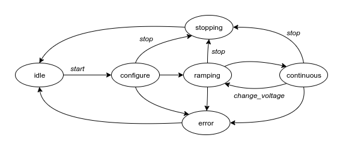

# Diode Measurement

IV/CV measurements for silicon sensors.

## Run

On Windows download a pre-built executable from the release section and run it.

## Install

Install using pip in a virtual environment.

```bash
pip install https://github.com/hephy-dd/diode-measurement/archive/refs/tags/0.24.0.tar.gz
```

## Build Executable

Building a Windows executable using PyInstaller.

```bash
# Create build environment
python3 -m venv build_env
. build_env/Scripts/activate

# Install dependencies
pip install --upgrade pip
pip install -e .
pip install -r .pyinstaller/requirements.txt

# Build executable
pyinstaller ./.pyinstaller/windows_app.spec
```

An executable will be created in `dist/diode-measurement-{version}.exe`

## Supported Instruments

Source Meter Units

- Keithley 237
- Keithley 2410
- Keithley 2470
- Keithley 2657A

Electro Meter

- Agilent 4155C (single SMU used as electrometer)
- Keithley 6514
- Keithley 6517B

LCR Meter

- Agilent 4284A
- Keithley 595
- Keithley 4215-CVU
- Keysight E4980A

DMM (Temperature)

- Keithley 2700

TCU (Temperature Control Unit)

- ERS AC3 Fusion (Thermal Chuck)

Switching Matrix

- HEPHY BrandBox (HV Switch)
- Keithley 707B
- Keithley 708B

## Setup

To interface instruments using a GPIB interface the NI-VISA drivers need to be
installed. Interfacing instruments using TCPIP, USB or Serial port is supported
out of the box by using PyVISA-py, pyusb and pyserial.

The instrument resource name inputs accept follwing formats:

|Format|Example|Result|
|:-----|:------|:-----|
|&lt;n&gt;|16|GPIB::16::INSTR|
|&lt;ip&gt;:&lt;port&gt;|0.0.0.0:1080|TCPIP::0.0.0.0::1080::SOCKET|
|&lt;host&gt;:&lt;port&gt;|localhost:1080|TCPIP::localhost::1080::SOCKET|
|&lt;visa&gt;|GPIB1::16::INSTR|GPIB1::16::INSTR|

## Data formats

The used plain text format consists of a header containing meta data in key and
value pairs and one or more CSV data tables with headers using `\t` separators.

### Synopsis

```
<key>: <value>
...
<<series>[<unit>]\t...>
<<value>\t...>
...
```

### IV

IV measurement data consist of up to two CSV tables with the second (optional)
table containing continuous measurement data.

#### Example

```csv
sample: Unnamed
measurement_type: iv
voltage_begin[V]: +5.000E+00
voltage_end[V]: -1.000E+01
voltage_step[V]: +1.000E+00
waiting_time[s]: +1.000E-01
current_compliance[A]: +1.000E-06

timestamp[s]	voltage[V]	v_smu[V]	i_smu[A]	i_elm[A]	i_elm2[A]	temperature[degC]
1629455368.29	+5.000E+00	+5.038E+00	+4.261E-08	+3.740E-08	+NAN	+NAN
1629455369.71	+4.000E+00	+4.065E+00	+7.708E-08	+9.495E-08	+NAN	+NAN
1629455370.49	+3.000E+00	+3.007E+00	+3.460E-08	+6.264E-08	+NAN	+NAN
...          	...       	...       	...       	...       	...       	...

timestamp[s]	voltage[V]	v_smu[V]	i_smu[A]	i_elm[A]	i_elm2[A]	temperature[degC]
1629455385.69	+3.000E+00	+3.046E+00	+3.996E-04	+7.137E-08	+NAN	+NAN
1629455387.65	+3.000E+00	+3.034E+00	+7.353E-04	+3.079E-08	+NAN	+NAN
1629455389.56	+3.000E+00	+3.021E+00	+9.081E-04	+1.266E-08	+NAN	+NAN
...          	...       	...       	...       	...       	...       	...
```

### IV Bias

IV bias measurement data consist of up to two CSV tables with the second
(optional) table containing continuous bias measurement data.

#### Example

```csv
sample: Unnamed
measurement_type: iv_bias
bias_voltage[V]: +1.000E+01
voltage_begin[V]: +5.000E+00
voltage_end[V]: -1.000E+01
voltage_step[V]: +1.000E+00
waiting_time[s]: +1.000E-01
current_compliance[A]: +1.000E-06

timestamp[s]	voltage[V]	v_smu[V]	i_smu[A]	v_smu2[V]	i_smu2[A]	i_elm[A]	i_elm2[A]	temperature[degC]
1629455368.29	+5.000E+00	+5.038E+00	+4.261E-08	+1.063E+01	+3.723E-08	+3.740E-08	+NAN	+NAN
1629455369.71	+4.000E+00	+4.065E+00	+7.708E-08	+1.051E+01	+6.513E-08	+9.495E-08	+NAN	+NAN
1629455370.49	+3.000E+00	+3.007E+00	+3.460E-08	+1.058E+01	+2.410E-08	+6.264E-08	+NAN	+NAN
...          	...       	...       	...       	...       	...       	...       	...       	...

timestamp[s]	voltage[V]	v_smu[V]	i_smu[A]	v_smu2[V]	i_smu2[A]	i_elm[A]	i_elm2[A]	temperature[degC]
1629455385.69	+3.000E+00	+3.046E+00	+3.996E-08	+1.063E+01	+2.657E-08	+7.137E-08	+NAN	+NAN
1629455387.65	+3.000E+00	+3.034E+00	+7.353E-08	+1.063E+01	+6.154E-08	+3.079E-08	+NAN	+NAN
1629455389.56	+3.000E+00	+3.021E+00	+9.081E-08	+1.063E+01	+8.426E-08	+1.266E-08	+NAN	+NAN
...          	...       	...       	...       	...       	...       	...       	...       	...
```

### CV

CV measurement data consist of a single CSV table containing the measurement
data.

#### Example

```csv
sample: Unnamed
measurement_type: cv
voltage_begin[V]: +5.000E+00
voltage_end[V]: -1.000E+01
voltage_step[V]: +1.000E+00
waiting_time[s]: +1.000E-01
current_compliance[A]: +1.000E-08

timestamp[s]	voltage[V]	v_smu[V]	i_smu[A]	c_lcr[F]	c2_lcr[F]	r_lcr[Ohm]	temperature[degC]
1629455368.29	+5.000E+00	+5.065E+00	+4.261E-08	+3.740E-05	7.149E+08	3.459932E-01	+NAN
1629455369.71	+4.000E+00	+4.037E+00	+7.708E-08	+9.495E-05	1.109E+08	3.015286E-01	+NAN
1629455370.49	+3.000E+00	+3.043E+00	+3.460E-08	+6.264E-05	2.549E+08	2.482018E-01	+NAN
...          	...       	...       	...       	...      	...      	...
```

## JSON-RPC

The application provides an [JSON-RPC](https://www.jsonrpc.org/) (remote
procedure call) version 2.0 interface using a TCP server.

### Methods

#### Start

Start notification starts a new measurement.

```json
{"jsonrpc": "2.0", "method": "start"}
```

Optional parameters are `continuous` (Boolean), `auto_reconnect` (Boolean),
`measurement_type` (String), `measurement_instruments` (List of String),
`begin_voltage` (Volt), `end_voltage` (Volt), `step_voltage` (Volt),
`waiting_time` (seconds), `compliance` (Ampere), `continue_in_compliance`
(Boolean), `waiting_time_continuous` (seconds), `sample` (String),
`output_enabled` (Boolean), `output_dir` (String), `filename` (String),
`filename_suffix` (String), `lcr_amplitude` (Volt) and `lcr_frequency`
(Hertz). Specified values will be applied to the user interface before
starting the measurement.

`continue_in_compliance` corresponds to the *Continue in Compliance* option:
when true the measurement keeps sweeping after the source reached its current
compliance instead of aborting, which is the normal case for a forward biased
diode.

Starting a measurement while another one is still active returns an error.

```json
{
  "jsonrpc": "2.0",
  "method": "start",
  "params": {
    "end_voltage": -100.0,
    "step_voltage": 10.0,
    "waiting_time": 1.0
  }
}
```

#### Configure

Configure notification applies parameters to the user interface without
starting a measurement. It accepts the same parameters as `start`.

```json
{
  "jsonrpc": "2.0",
  "method": "configure",
  "params": {
    "output_dir": "/data/samples/A1",
    "filename": "A1_irrad_iv",
    "filename_suffix": "iv_reverse",
    "lcr_frequency": 10000.0
  }
}
```

The written output file is `<output_dir>/<filename>_<filename_suffix>.txt`.
An empty `filename` falls back to `<sample>-<timestamp>`, an empty
`filename_suffix` is omitted. Writing output files requires `output_enabled`.

`lcr_amplitude` and `lcr_frequency` are applied to the instrument panel of the
currently selected LCR model and return an error if that model does not
support them.

#### Stop

Stop notification stops an active measurement.

```json
{"jsonrpc": "2.0", "method": "stop"}
```

#### Change voltage

Change voltage notification applies only during continuous It measurement.

Required parameter `end_voltage` (Volt).

Optional parameters with default values are `step_voltage` (default is `1.0`
Volt) and `waiting_time` (default is `1.0` seconds).

```json
{
  "jsonrpc": "2.0",
  "method": "change_voltage",
  "params": {
    "end_voltage": 100.0,
    "step_voltage": 10.0,
    "waiting_time": 0.25
  }
}
```

#### State

Request an application state snapshot.

```json
{"jsonrpc": "2.0", "method": "state", "id": 0}
```

This will return application state parameters.

```json
{
  "jsonrpc": "2.0",
  "result": {
    "state": "ramping",
    "running": true,
    "measurement_type": "iv",
    "sample": "VPX1",
    "filename": "/data/samples/A1/A1_irrad_iv_iv_reverse.txt",
    "last_error": null,
    "source_voltage": 24.0,
    "smu_voltage": 24.026,
    "smu_current": 0.0025,
    "smu2_voltage": null,
    "smu2_current": null,
    "elm_current": 0.0021,
    "elm2_current": null,
    "lcr_capacity": null,
    "temperature": 24.031
  },
  "id": 0
}
```

### States

Following states are exposed by the state snapshot: `idle`, `configure`,
`ramping`, `continuous`, `stopping`.

Field `running` is `true` from the moment a `start` request is accepted until
the measurement finished, also while ramping down. Use it rather than `state`
to wait for a measurement to complete, as it is free of races against short
measurements.

Field `last_error` contains the message of the most recent error, or `null` if
no error occurred since the current measurement was started. A measurement that
failed returns to `running` `false` with `last_error` set.



### Example

Example using [netcat](https://en.wikipedia.org/wiki/Netcat) to initiate a new
measurement and applies a new end voltage.

```bash
echo '{"jsonrpc": "2.0", "method": "start", "params": {"end_voltage": 100.0}}' | nc localhost 8000
```

Example using Python to read application state from TCP server.

```python
import json
import socket

with socket.socket(socket.AF_INET, socket.SOCK_STREAM) as sock:
    sock.connect(('localhost', 8000))
    request = {
      "jsonrpc": "2.0",
      "method": "state",
      "id": None
    }
    sock.sendall(json.dumps(request).encode('utf-8'))
    print(sock.recv(4096).decode('utf-8'))
```
